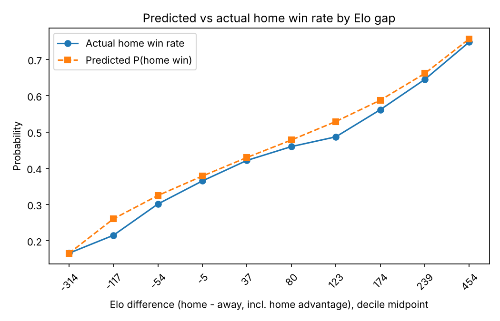
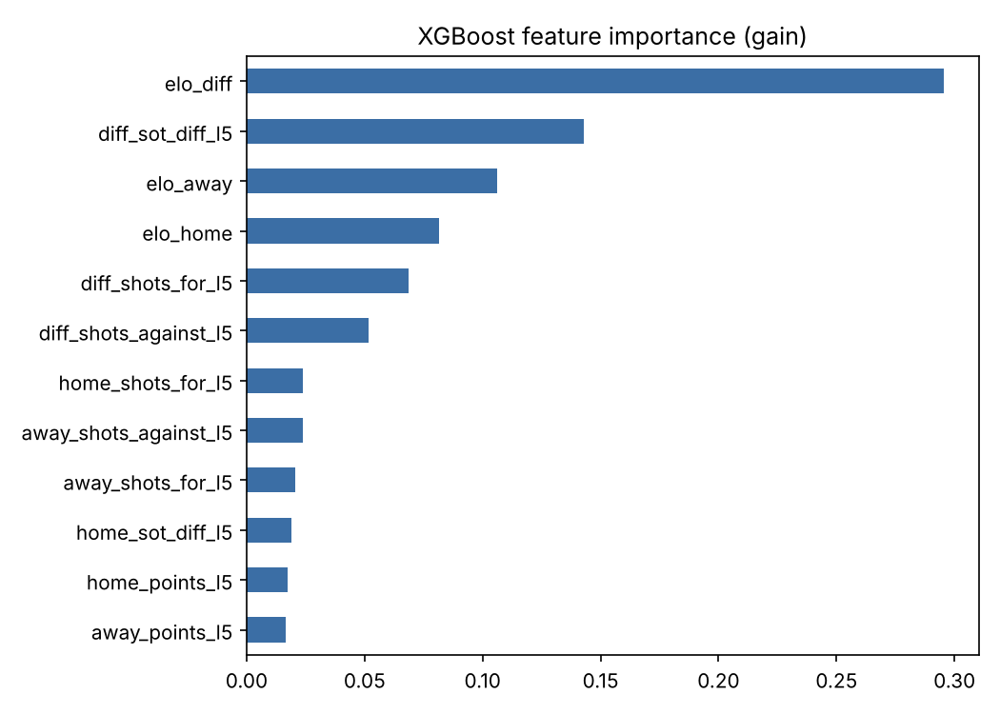
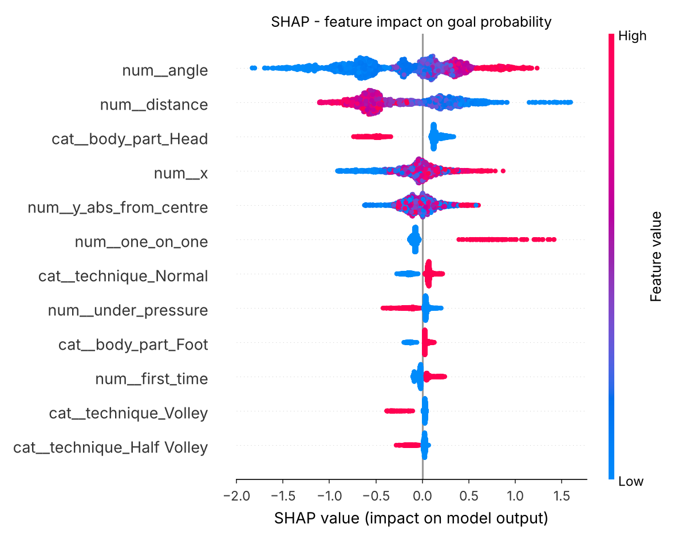
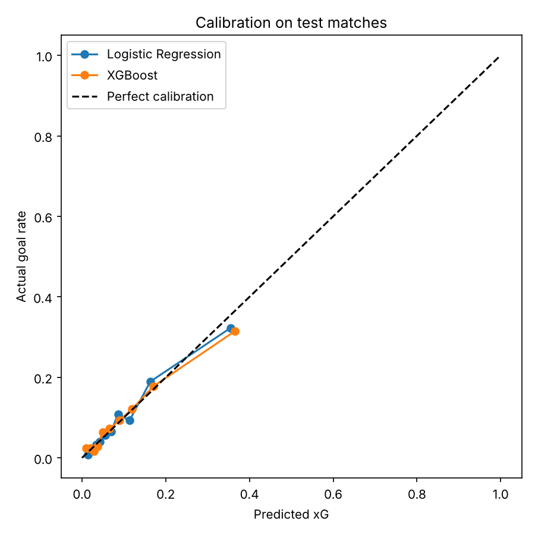
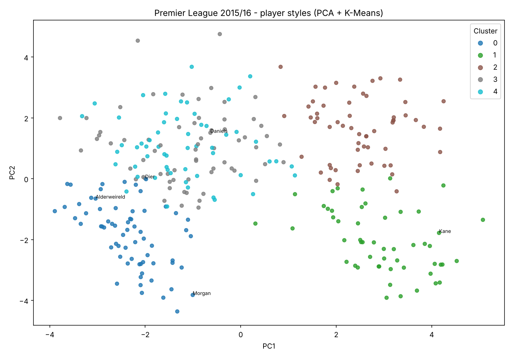

# Football Machine Learning Projects

Two end-to-end machine learning projects on real football data, covering **supervised classification**, **unsupervised clustering**, **feature engineering**, **leakage-free validation** and **model explainability**.

| Project | Task | Data | Techniques |
|---|---|---|---|
| [Match Outcome Predictor](match_predictor/) | Predict Home win / Draw / Away win | ~37,700 matches, top 5 European leagues, 2005/06–2025/26 | Elo ratings, rolling-form features, Logistic Regression, Random Forest, XGBoost, TimeSeriesSplit tuning, Ranked Probability Score |
| [Expected Goals (xG) + Player Styles](xg_model/) | Predict P(goal) for every shot, then cluster players by style | StatsBomb event data, Premier League 2015/16 (1.3M events) | Geometric feature engineering, Logistic Regression vs XGBoost, calibration, SHAP, PCA, K-Means, silhouette analysis |

---

## 1. Match Outcome Predictor

**Goal:** given only information available before kick-off, predict the probabilities of a home win, a draw and an away win.

### Features (all computed strictly from past matches)
- **Elo rating** for every team, implemented from scratch: updated after every match, with home advantage, a goal-margin multiplier and 25% regression to the mean between seasons.
- **Rolling form over the last 5 matches:** points, goals for/against, shots for/against, shots-on-target difference, plus home-minus-away differences.

### Validation
- **Time-based split:** train on 2006/07–2021/22 (29,005 matches), test on 2022/23–2025/26 (7,070 matches). A random split would leak future information.
- XGBoost hyperparameters tuned with `TimeSeriesSplit` cross-validation, so each fold validates on matches that come after its training data.

### Results (test set)

| Model | Accuracy | Log loss | RPS ↓ |
|---|---|---|---|
| Baseline (class priors) | 43.7% | 1.074 | 0.230 |
| Logistic Regression (Elo only) | 52.4% | 0.992 | 0.202 |
| **Logistic Regression (all features)** | **52.7%** | **0.986** | **0.200** |
| Random Forest | 52.4% | 0.988 | 0.201 |
| XGBoost (tuned) | 52.5% | 0.988 | 0.201 |

**RPS** (Ranked Probability Score) is the standard metric for football forecasts: it rewards probability mass placed close to the true outcome, since Home > Draw > Away is an ordered scale.

**Takeaways**
- A single well-built feature (Elo difference) captures most of the signal. Form features add a small but consistent improvement.
- More complex models do not beat a regularised linear model here, because the relationship is mostly monotonic and match outcomes are very noisy.
- Draws are almost never the single most likely outcome, a well-known property of football prediction. This is why probabilistic metrics matter more than accuracy.

<p float="left">
  
  
</p>

---

## 2. Expected Goals (xG) Model + Player Style Clustering

### Part A: xG model (supervised)
**Goal:** estimate the probability that a shot results in a goal.

- **Features:** distance to goal, shot angle (the angle between the two posts as seen from the shot location), body part, shot type, technique, under pressure, first time, one-on-one, counter-attack.
- **Split by match** (`GroupShuffleSplit`), so shots from the same game never appear in both train and test.
- **Class imbalance:** only 9.3% of shots are goals, so models are evaluated with ROC-AUC, Brier score and log loss instead of accuracy.

| Model | ROC-AUC | Brier |
|---|---|---|
| Constant baseline | 0.500 | 0.085 |
| Logistic Regression | 0.770 | 0.076 |
| XGBoost | 0.765 | 0.076 |
| StatsBomb's professional xG (benchmark) | 0.799 | 0.071 |

The models get close to StatsBomb's commercial model, which also uses information not included here (such as defender and goalkeeper positions). SHAP shows angle and distance dominate, headers reduce goal probability and one-on-one chances strongly increase it. Comparing actual goals with xG identifies elite finishers: Agüero scored +6.0 goals above expectation and Kane +4.5.

<p float="left">
  
  
</p>

### Part B: player style clustering (unsupervised)
- 300 outfield players with 900+ minutes, 15 per-90 statistics (passes, progressive passes and carries, dribbles, xG, tackles, pressures, interceptions, ...). Minutes are reconstructed from lineup and substitution events.
- Standardisation → K-Means (k chosen with silhouette score) → PCA for 2D visualisation.

The 5 clusters match real football roles without any position labels being used:

| Cluster | Defining stats | Examples |
|---|---|---|
| Centre-backs | clearances, interceptions | Alderweireld, Wes Morgan |
| Strikers | xG, shots | Kane, Vardy, Lukaku |
| Creative attackers | dribbles, progressive carries, key passes | Özil, Mahrez, Eriksen |
| Build-up passers | passes, long passes | Monreal, Cresswell |
| Ball-winning midfielders | tackles, pressures, recoveries | Gueye, Noble, Kouyaté |



---

## How to run

```bash
pip install -r requirements.txt

cd match_predictor && python match_predictor.py    # ~30 s
cd ../xg_model && python xg_model.py               # ~1.5 min (first run downloads ~1 GB of event data)
```

Data is downloaded automatically on the first run and cached in each project's `data/` folder (git-ignored). Plots and results are written to `outputs/`.

## Data sources
- Match results: [football-data.co.uk](https://www.football-data.co.uk), via the [datasets/football-datasets](https://github.com/datasets/football-datasets) GitHub mirror
- Event data: [StatsBomb Open Data](https://github.com/statsbomb/open-data)
